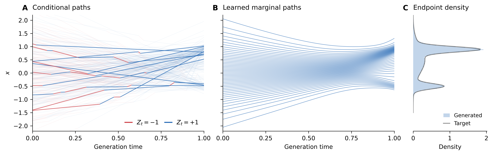

# One-dimensional switching example

A standalone LPGM example: a hidden sign changes the direction of a conditional
path, while a neural network learns the marginal velocity from position and time.
This directory has no dependency on the molecular models, datasets or viewer.

[PDF](figures/switching-01-right.pdf) · [SVG](figures/switching-01-right.svg) ·
[PNG](figures/switching-01-right.png) · [All six variants and both layouts](figures/README.md)



## Process and objective

Draw independent source and target values:

```math
X_0\sim\mathcal N(0,1),\qquad
X_1\sim0.2\,\mathcal N(-0.5,0.1^2)
      +0.4\,\mathcal N(0.9,0.1^2)
      +0.4\,\mathcal N(0.5,0.5^2).
```

The latent process consists of the coordinate and a sign $Z_t\in\{-1,+1\}$,
initially uniform. Its rates and coordinate dynamics are

```math
\lambda_{+\to-}(t)=6(1-t),\qquad
\lambda_{-\to+}(t)=\frac{6}{1-t},\qquad
\frac{dX_t}{dt}=\frac{Z_tX_1-X_t}{1-t}.
```

Observation projects the latent state onto its coordinate. Between sign switches
the conditional path is linear. The integrated rate of leaving the positive
state is finite, whereas the integrated return rate diverges at time one.
Consequently there are almost surely finitely many switches, the final sign is
positive, and the conditional path reaches its sampled endpoint.

The pushforward generator acting on a smooth function of the coordinate has
conditional drift $(Z_tX_1-X_t)/(1-t)$. Averaging conditional on the observed
coordinate gives the marginal drift

```math
v^*(x,t)=\frac{\mathbb E[Z_tX_1\mid X_t=x]-x}{1-t}.
```

A four-hidden-layer, width-128 SiLU network (50,049 parameters) represents
$v_\theta(x,t)$. Define its endpoint prediction as
$m_\theta(x,t)=x+(1-t)v_\theta(x,t)$ and minimize

```math
\mathbb E\!\left[w(t)
 \big(m_\theta(X_t,t)-Z_tX_1\big)^2\right],\qquad t\sim U(0,1).
```

Any positive time-only weight leaves the population conditional-mean minimizer
unchanged. Sampling integrates $dX_t/dt=v_\theta(X_t,t)$ from a Gaussian draw.
**The network and learned sampler receive only the current coordinate and time.**
The sign and target endpoint enter conditional simulation and training targets;
neither is available to the learned sampler.

## Figures and reproduction

From this directory, replotting needs only NumPy and Matplotlib:

```bash
pip install numpy matplotlib
python render.py
```

This redraws all six figures in both layouts as vector PDF/SVG and 600 dpi PNG.
Edit [plot.py](plot.py) for cosmetic changes. To render just the right-hand density
layout into a separate directory:

```bash
python render.py --layout right --output artifacts/figures
```

Panel A shows 250 simulated conditional paths at their exact switch vertices;
ten are highlighted using a fixed random selection. Panel B integrates the
trained network from Gaussian source quantiles 2%, 4%, …, 98%. Panel C uses
**100,000 random model-generated endpoints**, with the analytical target density
overlaid. The quantile paths are for display, not the histogram or random-sample
metrics. The variants change only the conditional draws. Axis limits crop the
view without discarding samples or renormalizing the histogram.

The EMA weights and plotting arrays are included in [reference/](reference/).
With PyTorch installed, redraw the paths from those weights on CPU:

```bash
pip install -r requirements.txt
python generate_paths.py --output artifacts/paths
python render.py --data artifacts/paths --output artifacts/figures
```

`generate_paths.py` retains the existing random-sample histogram. To regenerate
that histogram and all distribution checks, run the CUDA evaluation:

```bash
python assess.py --checkpoint reference/model.pt --output artifacts/evaluation
```

## Training

The supplied model uses three stages of the same regression objective:

| Stage | Simulated observations | Updates | Batch size | Time weight |
| --- | ---: | ---: | ---: | --- |
| 1 | 8 million | 50,000 | 4,096 | $1$ |
| 2 | 32 million | 100,000 | 8,192 | $(0.05+1-t)^{-2}$ |
| 3 | 64 million | 200,000 | 8,192 | $(0.005+1-t)^{-2}$ |

Each stage samples minibatches with replacement from a fixed simulated pool.
The simulator seed is reused, so these are nested pools, not 104 million distinct
observations. Validation uses a separate fixed set of 262,144 observations.
Training uses Adam, gradient clipping at 10, and EMA decay 0.999 with a shorter
startup average. The learning rate warms up for 500 updates and follows a cosine
schedule from 0.002 to 0.00001; continuation stages cap it at 0.0002.
Each continuation restores raw weights, EMA and optimizer state from the
preceding stage's best EMA-validation checkpoint, with a new stage schedule.

```bash
python train.py --output runs/fit
python train.py --output runs/refine --resume runs/fit/best.pt \
  --steps 100000 --train-size 32000000 --batch-size 8192 --time-floor 0.05
python train.py --output runs/final --resume runs/refine/best.pt \
  --steps 200000 --train-size 64000000 --batch-size 8192 --time-floor 0.005
```

The supplied EMA checkpoint was selected at stage-3 update 191,000; its parent
checkpoints were at stage-1 update 45,000 and stage-2 update 94,000. The late-time
weights and training duration were tuned using distribution diagnostics.
The reported final random-sample evaluation uses a separate seed; it is a
distributional accuracy check of this illustration, not an untouched benchmark.

## Checks

The saved figures were checked by regenerating all 100,000 histogram samples
from the trained EMA weights, as well as all 49 displayed learned paths and all
six conditional sets. These matched the saved arrays bit for bit in the recorded
environment. The learned sampler performs no endpoint correction, target-quantile
transport, rejection filtering or density-based adjustment.

The endpoint empirical CDF differs from the analytical target CDF by at most
0.00601 for the 100,000 random samples. A separate 8,192-quantile integration
check gives maximum CDF error 0.00396; doubling RK4 steps from 512 to 1,024 changes
endpoints by at most $4.30\times10^{-6}$. Full intermediate-marginal and endpoint
results are in [reference/metrics.json](reference/metrics.json).

```bash
python -m unittest discover -s tests
sha256sum -c reference/SHA256SUMS
```

`process.py` implements conditional simulation; `model.py` contains the network
and learned ODE sampler; `train.py` trains it; `assess.py` and `evaluate.py` check
distributions. Plotting code is separate from all training and sampling code.
