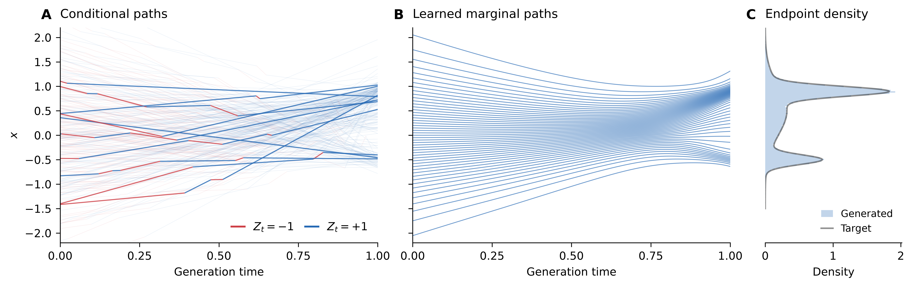

# Switching figures

Each row changes the conditional paths only. Learned quantile paths and the
100,000-sample endpoint histogram are shared. Both layouts are rendered by
[plot.py](../plot.py); [render.py](../render.py) redraws all variants.

| Conditional draw | Density on the right | Density below |
| --- | --- | --- |
| 1 | [PDF](switching-01-right.pdf) · [SVG](switching-01-right.svg) · [PNG](switching-01-right.png) | [PDF](switching-01.pdf) · [SVG](switching-01.svg) · [PNG](switching-01.png) |
| 2 | [PDF](switching-02-right.pdf) · [SVG](switching-02-right.svg) · [PNG](switching-02-right.png) | [PDF](switching-02.pdf) · [SVG](switching-02.svg) · [PNG](switching-02.png) |
| 3 | [PDF](switching-03-right.pdf) · [SVG](switching-03-right.svg) · [PNG](switching-03-right.png) | [PDF](switching-03.pdf) · [SVG](switching-03.svg) · [PNG](switching-03.png) |
| 4 | [PDF](switching-04-right.pdf) · [SVG](switching-04-right.svg) · [PNG](switching-04-right.png) | [PDF](switching-04.pdf) · [SVG](switching-04.svg) · [PNG](switching-04.png) |
| 5 | [PDF](switching-05-right.pdf) · [SVG](switching-05-right.svg) · [PNG](switching-05-right.png) | [PDF](switching-05.pdf) · [SVG](switching-05.svg) · [PNG](switching-05.png) |
| 6 | [PDF](switching-06-right.pdf) · [SVG](switching-06-right.svg) · [PNG](switching-06-right.png) | [PDF](switching-06.pdf) · [SVG](switching-06.svg) · [PNG](switching-06.png) |

