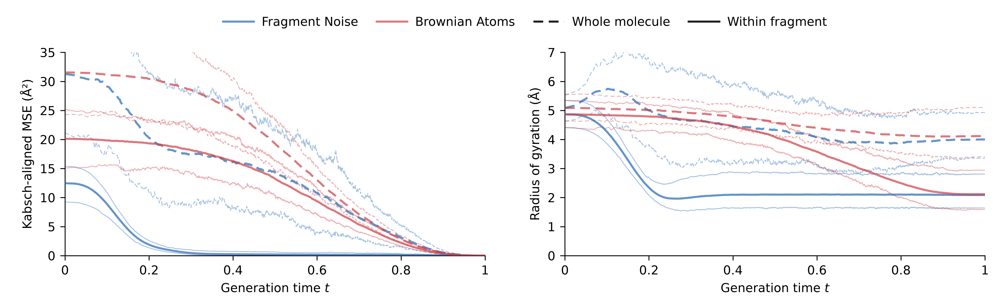
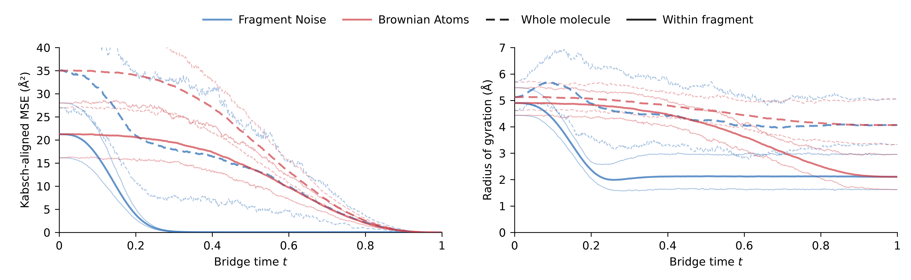

# Molecular path figures

This directory is independent of the neural network, training scripts, and web
viewer. Replotting needs only NumPy and Matplotlib; no checkpoint or GPU is needed.

## Figures

| Paths | Display | PDF | SVG | PNG | Curve data |
| --- | --- | --- | --- | --- | --- |
| Generated | Mean + central 90% | [PDF](generated/geom-error-and-radius-quantiles.pdf) | [SVG](generated/geom-error-and-radius-quantiles.svg) | [PNG](generated/geom-error-and-radius-quantiles.png) | [Quantiles CSV](generated/quantile-curves.csv) |
| Conditional | Mean + central 90% | [PDF](conditional/geom-conditional-error-and-radius-quantiles.pdf) | [SVG](conditional/geom-conditional-error-and-radius-quantiles.svg) | [PNG](conditional/geom-conditional-error-and-radius-quantiles.png) | [Quantiles CSV](conditional/quantile-curves.csv) |
| Generated | Mean + individual paths | [PDF](generated/geom-error-and-radius.pdf) | [SVG](generated/geom-error-and-radius.svg) | [PNG](generated/geom-error-and-radius.png) | [Means CSV](generated/mean-curves.csv) |
| Conditional | Mean + individual paths | [PDF](conditional/geom-conditional-error-and-radius.pdf) | [SVG](conditional/geom-conditional-error-and-radius.svg) | [PNG](conditional/geom-conditional-error-and-radius.png) | [Means CSV](conditional/mean-curves.csv) |

The compact versions show thick mean curves and thin **5th and 95th percentile**
curves, calculated across the 100 molecules separately at each time. These are
pointwise central 90% ranges, not confidence intervals for the means. Quantiles
use linear interpolation between ranked values. No individual trajectories are
drawn, and the means are identical in both versions.





## Replot

From the repository root:

```bash
python figures/plot.py --data figures/reference/generated.npz --output-dir artifacts/figures/generated --spread quantiles
python figures/plot.py --data figures/reference/conditional.npz --output-dir artifacts/figures/conditional --spread quantiles
```

Each command writes a vector PDF and SVG, a 600 dpi PNG, CSVs of the mean and
quantile curves, and a small JSON description. Use `--spread individual` for the
individual-path versions. Blue denotes **Fragment Noise** and red denotes
**Brownian Atoms**. Dashed lines describe the whole molecule; solid lines describe
individual fragments. Mean lines have opacity 0.7; quantile lines are thinner
with opacity 0.4. In the individual-path version, faint paths underlie the means.
Both figures use the switching example's blue/red palette, 9 pt DejaVu Sans
type, and thin black axes, in a 10.2 × 3.15 inch layout. The visible y ranges
are 0–40 Ų for conditional-path MSE, 0–35 Ų for generated-path MSE,
and 0–7 Å for radius of gyration. Values outside these
ranges still contribute to every mean; only the display is cropped.

## Measurements

For each path, errors compare the current coordinates with that path's own final
coordinates. Whole-molecule MSE uses one Kabsch alignment; within-fragment MSE
aligns each fragment independently. Alignments allow translation and proper
rotation, with fixed atom correspondence and no reflection or atom permutation.
MSE is the mean **squared Euclidean distance per atom**, in Ų, not a mean over
Cartesian components. Fragments contribute in proportion to their atom counts.

The second panel shows equal-atom radii of gyration in Å. The whole-molecule
radius is the RMS distance to the molecular centroid; the within-fragment radius
is the RMS distance to each atom's fragment centroid. Take the square root for
each molecule before averaging across molecules. All curves weight molecules
equally. There is no quality filtering, smoothing, baseline subtraction, or
normalization by the initial error.

## Supplied reference data

Both arrays describe the same 100 GEOM test cases with at least two fragments,
selected before evaluating sample quality.

- `generated.npz`: final 800K EMA models, 2,000 square-root-spaced sampling steps.
  Each pair shares identical initial coordinates and fragment assignments.
  Its two generated endpoints can differ, so initial errors to those endpoints
  need not match. Initial radii do match exactly.
- `conditional.npz`: the training conditional processes, observed at 901 times.
  Each pair shares both its Gaussian source and its randomly rotated dataset
  endpoint, as well as its label path. These Gaussian sources are new draws,
  rather than those used in the generated-path figure.

Every metric array has shape `(molecules, times)`. Keys follow
`{fragment,bm}_{mse,rg}_{total,fragment}`; `time` and `sample_indices` identify the
axes. `provenance.json` records the checkpoint checksums and process settings;
`SHA256SUMS` records the supplied files' checksums.

## Measure other trajectories

`metrics.py` reads the viewer trajectory format: `trajectory.json` metadata and
a sibling little-endian float32 `positions.f32` with shape `(frames, atoms, 3)`.
Create a JSON list of pairs, with paths relative to that list:

```json
[{"sample_index": 1, "fragment": "fragment/sample_000001/trajectory.json",
  "bm": "bm/sample_000001/trajectory.json"}]
```

```bash
python figures/metrics.py --pairs pairs.json --output metrics.npz
python figures/plot.py --data metrics.npz --output-dir figures-output
```

The measurement script checks atom identities, fragment assignments, time grids,
and identical initial coordinates. `--conditional` also requires identical final
coordinates. TOML metadata and a TOML list under `pairs` are supported as well.

## Reproduce the conditional paths

With the prepared GEOM corpus and the Julia environment installed:

```bash
julia --project=julia figures/conditional_paths.jl --corpus=data/geom --output=artifacts/conditional-paths
python figures/metrics.py --pairs artifacts/conditional-paths/pairs.toml --conditional --output artifacts/conditional-metrics.npz
python figures/plot.py --data artifacts/conditional-metrics.npz --output-dir artifacts/figures/conditional
```

The producer calls `MolLPGMPrep.sample_molecular_path`, the training-process
implementation. `reference/conditional-selection.toml` fixes cases and seeds;
`--selection=FILE` permits another selection and `--limit=N` a smaller subset.
The observation grid preserves monotonicity of the production Float32 clocks.
At the two boundaries, the known analytical endpoints replace reconstruction
roundoff (below 0.000008 Å in the supplied paths). Native boundary values are
retained separately; interior coordinates are unchanged.
